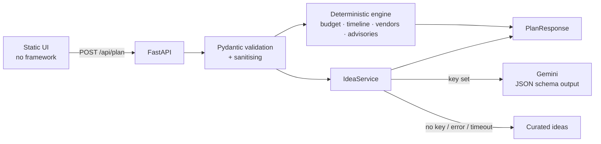

# Celebration & Event Planner

A planning assistant for **weddings, birthdays and community events**. Give it
the date, guest count, budget and a few preferences. It returns a budget split
with reasons, a dated checklist, vendor questions and personalised ideas.

**Challenge vertical:** Challenge 5, Celebration & Event Planner.

## How it works



**Split of responsibilities.** Everything that must be *correct* (money, dates,
checklists) is plain, deterministic, tested Python. Gemini is used only where
creativity helps (themes, activities, menu and personal touches). If Gemini is
missing, slow or returns bad output, the app falls back to curated ideas, so
the plan is never blocked on an AI call.

### Decision logic (context in, decisions out)

| Context | Decision |
|---|---|
| Budget per guest vs. a currency floor | **Tier** (lean / standard / premium). Lean protects food and venue and trims extras. Premium adds room for upgrades. |
| Up to 3 priorities | Boosts the matching budget category by 25% and re-normalises. |
| Dietary needs | Extra catering allowance, plus a dietary question added to the caterer checklist. |
| Outdoor setting | Larger contingency, a weather-backup milestone, and a tent/rentals vendor. |
| Days until the event | If shorter than the ideal lead time, **every lead time is scaled proportionally** (order is preserved, nothing is due in the past) and critical items are flagged. |
| Honoree age ≤ 12, guests ≥ 50 (weddings), crowd ≥ 150 | Supervision, guest-travel and safety milestones and advisories appear only when relevant. |
| City, tradition, theme, notes | Passed to Gemini (as data) and used by the curated fallback. |

Budget amounts use the **largest-remainder method** on integers, so the lines
always sum to exactly the budget (checked by property-based tests).

## Run it

```bash
python -m venv .venv && source .venv/bin/activate
pip install -r requirements.txt
cp .env.example .env            # optional: add GEMINI_API_KEY
export $(grep -v '^#' .env | xargs)   # or set variables your own way
PYTHONPATH=src python -m planner      # http://localhost:8080
```

Without `GEMINI_API_KEY` the app runs fully on curated ideas. The model is set
with `GEMINI_MODEL` (default `gemini-3.1-flash-lite`). Check the current model
names in Google AI Studio before the demo, because Google retires models.

**Docker / Cloud Run:** `docker build -t planner . && docker run -p 8080:8080 -e GEMINI_API_KEY planner`.
The image runs as a non-root user and honours `$PORT`.

## Test

```bash
pip install -r requirements-dev.txt
ruff check . && ruff format --check . && mypy src && pytest
```

58 tests, about 97% line and branch coverage (gate at 90%): unit tests,
property-based tests (Hypothesis) for budget and schedule invariants, API tests,
security tests, and fault-injection tests for the Gemini path (timeout, bad
JSON, empty output, empty themes). CI is in `.github/workflows/ci.yml`.

## Evaluation criteria → where to look

| Criterion | What was done |
|---|---|
| **Code quality** | Small single-purpose modules (`budget`, `schedule`, `timeline`, `vendors`, `ideas`, …). Planning knowledge lives in `catalog.py` as data, separate from the engine. Pure functions with injected clock. Strict `mypy`, `ruff` (incl. Google docstring convention), 80-column Google style. |
| **Security** | Strict Pydantic models (`extra="forbid"`, bounds, enums). Unicode normalisation, control/bidi stripping. CSP (`default-src 'self'`, no inline script or style), HSTS, `nosniff`, `frame-ancestors 'none'`. Body-size limit (declared and streamed). Per-client rate limiting. Validation errors never echo input. Generic 500s with a request id. No secrets in the repo. Prompt-injection defence: user text is JSON data, the system prompt marks it untrusted, output is schema-constrained then sanitised (no URLs or markup). UI uses `textContent` only. |
| **Efficiency** | Planning is O(n) over small tables. One Gemini call per new request, with a hard timeout, a token cap, and a TTL+LRU cache. Bounded memory for cache and rate limiter. GZip. No front-end framework or external assets (about 24 KB total). |
| **Testing** | See above. Design for testability: clock, idea provider and settings are injectable. |
| **Accessibility** | Semantic landmarks, skip link, labelled controls and fieldsets, `aria-live` status, error summary with `role="alert"`, focus moves to results, 44 px targets, visible focus, AA contrast, dark mode, reduced motion, forced-colors and print styles, works at 200% zoom and on mobile. |
| **Problem alignment** | Budgets, timelines, vendor checklists and personalised ideas for all three event types, with logic driven by the user's context, plus calendar (.ics) export and a printable plan. |

## API

* `GET /api/health`
* `POST /api/plan` → `{plan, ideas, ideas_source, generated_at}`
* `POST /api/plan.ics` → timeline as an iCalendar file (no AI call)
* `GET /api/openapi.json`

## Assumptions and limits

* Per-guest spending floors (for example ₹400, $10) are rough heuristics used
  only to pick the tier. They are not market quotes.
* Budget percentages and lead times are sensible defaults, not guarantees. Local
  prices and vendor availability vary.
* Dates are compared with "today" in `APP_TIMEZONE` (default UTC).
* Rate limiting is in memory per instance. Use an edge limiter for multi-instance
  production. Behind one trusted proxy (Cloud Run) set `TRUST_PROXY=true`.
* Nothing is stored: no database, no accounts, no logging of user text.
* Checklist ticks live in the page and reset on reload.
