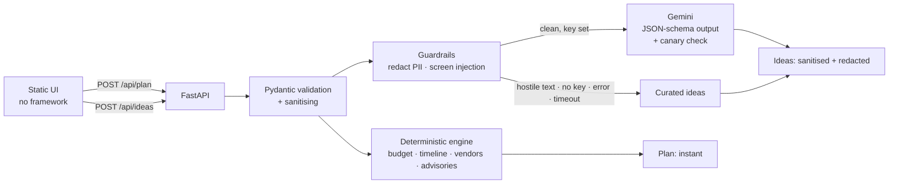

# Celebration & Event Planner

A planning assistant for **weddings, birthdays and community events**. Give it
the date, guest count, budget and a few preferences. It returns a budget split
with reasons, a dated checklist, vendor questions and personalised ideas.

**Status:** single branch (`main`) · repo well under 10 MB · 93 Python tests
(about 97% line and branch coverage) · 9 browser-level UI tests with
axe-core · strict `mypy` and `ruff` clean · dependency and secret audits
clean. Run `./scripts/preflight.sh` to check every gate yourself.

## 1. Chosen vertical and persona

* **Vertical:** Challenge 5, Celebration & Event Planner.
* **Primary user:** a first-time organiser (a parent, a family member, a
  neighbourhood volunteer) with a fixed budget, a date, and a long list of
  things they do not know they have forgotten. They expect a search engine or
  a helpful relative, not a black box.
* **Root challenge:** a generic chatbot gives the same answer to a ₹30,000
  birthday and a ₹18 lakh wedding, ignores how many days are left, and invents
  numbers that do not add up. Planning needs *correct* money and dates, and
  *creative* ideas. This project keeps those two jobs separate.

## 2. Approach and decision logic

**Deterministic first, AI second.** Everything that must be right (money,
dates, checklists) is plain, tested Python. Gemini only writes the creative
part (themes, activities, menu, personal touches) and is never trusted with
numbers. If it is missing, slow, or returns bad output, the user still gets a
complete plan with curated ideas.



The plan returns in milliseconds. Ideas load in a second request so a slow
model never blocks the user.

| Context | Decision |
|---|---|
| Budget per guest vs. a currency floor | **Tier** (lean / standard / premium). Lean protects food and venue and trims extras. Premium adds room for upgrades. |
| Up to 3 priorities | Boosts the matching budget category by 25% and re-normalises. |
| Dietary needs | Extra catering allowance, plus a dietary question added to the caterer checklist. |
| Outdoor setting | Larger contingency, a weather-backup milestone, and a tent/rentals vendor. |
| Days until the event | If shorter than the ideal lead time, **every lead time is scaled proportionally** (order is kept, nothing is due in the past) and critical items are flagged. |
| Honoree age ≤ 12, guests ≥ 50 (weddings), crowd ≥ 150 | Supervision, guest-travel and safety milestones and advisories appear only when relevant. |
| City, tradition, theme, notes | Sent to Gemini as data (personal details masked) and used by the curated fallback. |

Budget amounts use the **largest-remainder method** on integers, so lines
always sum to exactly the budget (property-based tests check this for random
inputs).

### Responsible AI (trust and autonomy)

* **Explains itself:** every budget line says why it changed; a "How this plan
  was made" note separates rule-based results from AI suggestions.
* **Labels AI output** and asks users to confirm details with vendors.
* **Fails safe and visibly:** model failure falls back to curated ideas and
  the UI says which source was used.
* **No autonomous actions:** the app books, sends and stores nothing. There are
  no tools, no agent loops and exactly one model call per request.

## 3. How it works

1. The UI posts the answers to `/api/plan` and renders the result immediately.
2. It then calls `/api/ideas`. The service masks emails, phone/card-like
   numbers and API keys in free text, screens it for instruction-override
   phrases (a match routes to curated ideas and never calls the model), then
   calls Gemini once with a timeout, a token cap and schema-constrained JSON.
3. Model output is validated, stripped of URLs and markup, masked again, and
   cached. A per-request canary in the system prompt catches prompt leaks.
4. The timeline can be exported as an `.ics` calendar file or printed.

## 4. Run it

```bash
python -m venv .venv && source .venv/bin/activate
pip install -r requirements.txt
cp .env.example .env            # optional: add GEMINI_API_KEY
export $(grep -v '^#' .env | xargs)
PYTHONPATH=src python -m planner      # http://localhost:8080
```

Without `GEMINI_API_KEY` the app runs fully on curated ideas. The model is set
with `GEMINI_MODEL` (default `gemini-3.1-flash-lite`); check current model
names in Google AI Studio, because Google retires models.

**Docker / Cloud Run:** `docker build -t planner . && docker run -p 8080:8080 -e GEMINI_API_KEY planner`.
The image runs as a non-root user and honours `$PORT`.

**Vercel:** Import this repository into Vercel. It is configured via `vercel.json` and `api/index.py`. Add `TRUST_PROXY=true` and optionally `GEMINI_API_KEY` under Project Settings → Environment Variables.

## 5. Test

```bash
pip install -r requirements-dev.txt
./scripts/preflight.sh      # lint, types, tests, UI tests, audits, size, branch
```

* **Python (93 tests):** unit, property-based (Hypothesis) for budget and
  schedule invariants, API, security, and fault injection for the Gemini path
  (timeout, bad JSON, empty output, prompt leak, hostile input). Contrast
  ratios are computed from the real stylesheet and checked against WCAG AA in
  light and dark themes.
* **UI (9 tests, Node):** the real page and script run in jsdom with a stubbed
  network: example starters, priority limit, progressive rendering, hostile
  text rendered as text, error and rate-limit messages, and an **axe-core
  audit with zero violations** before and after results render.
* Tests use small hand-written fakes instead of mocks, so they assert on
  results, not on internal calls.

## 6. CI/CD

GitHub Actions runs the lint, format, type, API, accessibility, dependency and
secret checks on every push and pull request. A push to `main` deploys only
after both test jobs pass, then verifies `GET /api/health` and the public home
page before marking the deployment successful.

Create these repository secrets before enabling production deployment:

| Secret | Value |
|---|---|
| `VERCEL_TOKEN` | A Vercel token with access to this project. |
| `VERCEL_ORG_ID` | The Vercel team or personal-account ID. |
| `VERCEL_PROJECT_ID` | The Vercel project ID. |

In GitHub, make the `test` and `ui` checks required for `main`. If the project
is also connected to Vercel's Git integration, disable automatic production
deployments there so this workflow is the only production deployment path.

## 7. Evaluation criteria → where to look

| Criterion | What was done |
|---|---|
| **Code quality** | Small single-purpose modules (`budget`, `schedule`, `timeline`, `vendors`, `guardrails`, `ideas`, …). Planning knowledge is data in `catalog.py`. Pure functions with an injected clock; the model sits behind an `IdeaProvider` interface. Strict `mypy`, `ruff` (Google docstring convention), 80-column style, small logical commits. |
| **Security** | Strict Pydantic models (`extra="forbid"`, bounds, enums); Unicode normalisation; CSP with no inline script or style, HSTS, `nosniff`, `X-Frame-Options`; body-size limit (declared and streamed); per-client rate limiting; errors never echo input; generic 500s with a request id; no secrets in the repo. AI: PII masking (LLM02), user text as JSON data plus an "untrusted" system prompt and injection screening (LLM01), schema-constrained then sanitised output (LLM05), canary leak check (LLM07), one capped call and no tools (LLM06, LLM10). UI uses `textContent` only. |
| **Efficiency** | O(n) planning over small tables. Plan returns instantly; ideas load separately. One Gemini call per new request with a hard timeout, token cap, and TTL+LRU cache. Bounded memory for cache and rate limiter. GZip. No front-end framework or external assets (about 28 KB). |
| **Testing** | See section 5. Clock, provider and settings are injectable. CI runs lint, types, tests, UI tests, dependency audit and a secret scan. |
| **Accessibility** | Landmarks, skip link, labelled controls and fieldsets, live status that announces plan and ideas once (not token by token), `aria-busy` while ideas load, error summary with `role="alert"`, focus moves to results, 44 px targets (WCAG 2.2 asks 24 px), visible focus, AA contrast (tested), dark mode, reduced motion, forced-colors, print styles, example starters to reduce typing. |
| **Problem alignment** | Budgets, timelines, vendor checklists and personalised ideas for all three event types, driven by the user's context, plus calendar export and a printable plan. |

## 8. API

* `GET /api/health`
* `POST /api/plan` → the deterministic plan
* `POST /api/ideas` → `{ideas, ideas_source, generated_at}`
* `POST /api/plan.ics` → timeline as an iCalendar file
* `GET /api/openapi.json`

## 9. Assumptions and limits

* Per-guest spending floors (for example ₹400, $10) are rough heuristics used
  only to pick the tier. They are not market quotes.
* Budget percentages and lead times are sensible defaults, not guarantees.
  Local prices and vendor availability vary.
* Dates are compared with "today" in `APP_TIMEZONE` (default UTC).
* Rate limiting is in memory per instance. Use an edge limiter for
  multi-instance production. Behind one trusted proxy (Cloud Run) set
  `TRUST_PROXY=true`.
* Pattern-based screening cannot stop every prompt injection. It is one layer;
  the structural controls above are the real defence.
* Nothing is stored: no database, no accounts, no logging of user text.
* Checklist ticks live in the page and reset on reload.
